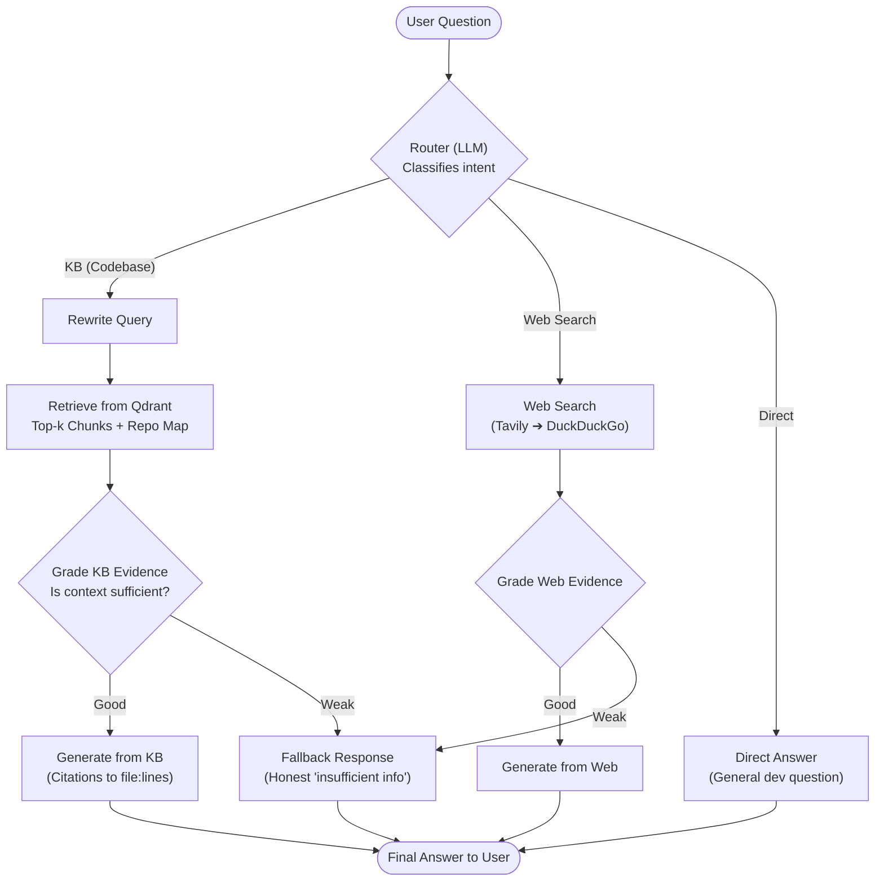

# Agentic Codebase RAG Assistant

An agentic RAG system that answers natural-language questions about any
GitHub repository — architecture, specific functions, error messages — with
citations to exact files and lines. Falls back to live web search for
things the codebase itself can't explain, and is honest when neither source
has good evidence.

Built entirely on free/open-source tooling — no paid API keys required.

---

## Why this project

Every engineering org runs internal codebase onboarding and support at
scale — new engineers spend weeks reading unfamiliar code, asking seniors
"why does this work this way," and Googling stack traces. This compresses
that process into a chat interface, grounded in the actual repo rather than
guesswork.

It's also designed to be more than "RAG with extra steps": a router decides
*where* to look, a grading step self-corrects when retrieval comes back
weak, and a sandboxed code-execution tool lets the agent verify its own
explanations against real runtime behavior rather than just describing code.

---

## Architecture

[](https://gitdiagram.com/muralikrishna1729/codesage?utm_source=readme&utm_medium=picture)

### System & Ingestion Flow

```mermaid
%% Generated by https://gitdiagram.com/muralikrishna1729/codesage
flowchart TD

subgraph group_api["API and entry"]
  node_api_routes["HTTP API<br/>[routes.py]"]
end

subgraph group_ingestion["Repository ingestion"]
  node_clone["Repository clone<br/>[clone.py]"]
  node_chunker["Code chunking<br/>[chunker.py]"]
  node_repo_map["Repository map<br/>[repo_map.py]"]
  node_embed_store["Embedding and retrieval<br/>[embed_store.py]"]
end

subgraph group_agent["Agent workflow"]
  node_graph["Workflow orchestration<br/>[graph.py]"]
  node_state["Agent state<br/>[state.py]"]
  node_agent_nodes["Routing and answer nodes<br/>[nodes.py]"]
end

subgraph group_services["Models and search"]
  node_qdrant[("Qdrant vector store")]
  node_embed_model["Sentence Transformers"]
  node_llm_client["LLM provider client<br/>[llm_client.py]"]
  node_config["Runtime settings<br/>[config.py]"]
  node_web_search["Web search tool<br/>[web_search.py]"]
end

node_user(("User"))
node_llm_providers["Groq, OpenRouter, Gemini"]
node_web_providers["Tavily and DuckDuckGo"]
node_answer["Answer and source"]

node_user -->|"submits request"| node_api_routes
node_api_routes -->|"clones repository"| node_clone
node_api_routes -->|"chunks repository"| node_chunker
node_api_routes -->|"stores chunks"| node_embed_store
node_embed_store -->|"encodes chunks"| node_embed_model
node_embed_store -->|"writes and searches"| node_qdrant
node_api_routes -->|"invokes chat workflow"| node_graph
node_graph -->|"types workflow state"| node_state
node_graph -->|"dispatches workflow steps"| node_agent_nodes
node_agent_nodes -->|"retrieves code context"| node_embed_store
node_agent_nodes -->|"routes and generates"| node_llm_client
node_agent_nodes -->|"searches web evidence"| node_web_search
node_llm_client -->|"reads provider settings"| node_config
node_llm_client -->|"calls providers"| node_llm_providers
node_web_search -->|"reads search settings"| node_config
node_web_search -->|"searches with fallback"| node_web_providers
node_graph -->|"returns final result"| node_answer
node_user -->|"receives response"| node_answer
node_repo_map -.->|"adds structural retrieval context"| node_embed_store

click node_api_routes "https://github.com/muralikrishna1729/codesage/blob/main/app/api/routes.py"
click node_clone "https://github.com/muralikrishna1729/codesage/blob/main/app/ingestion/clone.py"
click node_chunker "https://github.com/muralikrishna1729/codesage/blob/main/app/ingestion/chunker.py"
click node_repo_map "https://github.com/muralikrishna1729/codesage/blob/main/app/ingestion/repo_map.py"
click node_embed_store "https://github.com/muralikrishna1729/codesage/blob/main/app/ingestion/embed_store.py"
click node_graph "https://github.com/muralikrishna1729/codesage/blob/main/app/agent/graph.py"
click node_state "https://github.com/muralikrishna1729/codesage/blob/main/app/agent/state.py"
click node_agent_nodes "https://github.com/muralikrishna1729/codesage/blob/main/app/agent/nodes.py"
click node_llm_client "https://github.com/muralikrishna1729/codesage/blob/main/app/agent/llm_client.py"
click node_config "https://github.com/muralikrishna1729/codesage/blob/main/app/config.py"
click node_web_search "https://github.com/muralikrishna1729/codesage/blob/main/app/tools/web_search.py"

classDef toneNeutral fill:#f8fafc,stroke:#334155,stroke-width:1.5px,color:#0f172a
classDef toneBlue fill:#dbeafe,stroke:#2563eb,stroke-width:1.5px,color:#172554
classDef toneAmber fill:#fef3c7,stroke:#d97706,stroke-width:1.5px,color:#78350f
classDef toneMint fill:#dcfce7,stroke:#16a34a,stroke-width:1.5px,color:#14532d
classDef toneRose fill:#ffe4e6,stroke:#e11d48,stroke-width:1.5px,color:#881337
classDef toneIndigo fill:#e0e7ff,stroke:#4f46e5,stroke-width:1.5px,color:#312e81
classDef toneTeal fill:#ccfbf1,stroke:#0f766e,stroke-width:1.5px,color:#134e4a
class node_api_routes,node_user toneBlue
class node_clone,node_chunker,node_repo_map,node_embed_store toneAmber
class node_graph,node_state,node_agent_nodes,node_llm_providers toneMint
class node_qdrant,node_embed_model,node_llm_client,node_config,node_web_search toneRose
class node_web_providers,node_answer toneIndigo
```



### Agent Decision & Self-Correction Workflow (LangGraph)



**How the agent understands a codebase — 3 layers:**
1. **File-level chunking** — tree-sitter parses each file's AST and extracts
   function/class boundaries with exact `file_path:start_line-end_line`
   metadata, so every chunk is a complete, citable unit of code.
2. **Structural understanding** — a directory-tree summary, import graph,
   and README/config ingestion give the agent the shape of the whole
   project, not just isolated functions — needed for "how does X work"
   questions that span multiple files.
3. **Retrieval-time context assembly** — the stored repo-map chunk is
   included alongside normal top-k code chunks so architecture-flavored
   questions get both the big picture and the specific detail.

---

## Tech stack (100% free / open-source)

| Layer | Tool | Notes |
|---|---|---|
| LLM (primary) | Groq — `openai/gpt-oss-120b` | Free tier, no card required |
| LLM (fallback 1) | OpenRouter free pool (`:free` models) | Kicks in on Groq rate limit |
| LLM (fallback 2) | Gemini free tier | Also used as RAGAS eval judge |
| Embeddings | `sentence-transformers/all-MiniLM-L6-v2` | Local, no API needed |
| Vector DB | Qdrant (self-hosted via Docker) | Free, production-grade |
| Web search (primary) | Tavily | Free: 1,000 queries/month |
| Web search (fallback) | `duckduckgo-search` | Free, no key |
| Code parsing | tree-sitter | AST-aware chunking (Python, JS/TS) |
| Orchestration | LangGraph | Router → grade → generate state machine |
| Backend | FastAPI | `/ingest`, `/ingest/async` + `/ingest/status`, `/chat`, `/chat/debug`, `/repos` |
| Frontend | Streamlit | Chat UI with visible agent reasoning steps |
| Code execution sandbox | Docker (network-isolated, resource-capped) | Verifies agent's code explanations |
| Eval | RAGAS | Faithfulness + answer relevancy scoring |

---

## Project structure

```
codebase-rag-agent/
├── requirements.txt
├── docker-compose.yml
├── .env.example
├── app/
│   ├── config.py
│   ├── ingestion/
│   │   ├── clone.py
│   │   ├── chunker.py
│   │   ├── repo_map.py
│   │   └── embed_store.py
│   ├── agent/
│   │   ├── state.py
│   │   ├── llm_client.py
│   │   ├── nodes.py
│   │   └── graph.py
│   ├── tools/
│   │   ├── web_search.py
│   │   └── code_exec.py
│   ├── api/
│   │   └── routes.py
│   └── frontend/
│       └── streamlit_app.py
└── eval/
    ├── eval_dataset.py
    └── run_eval.py
```

---

## Setup

### Prerequisites
- Python 3.13 (required — see the version note under Install)
- Docker (for Qdrant and the code-execution sandbox)
- Free API keys: [Groq](https://console.groq.com), [OpenRouter](https://openrouter.ai),
  [Google AI Studio / Gemini](https://aistudio.google.com), [Tavily](https://tavily.com)

### Install
```bash
git clone <this-repo-url>
cd codebase-rag-agent

docker compose up -d              # starts Qdrant on localhost:6333
pip install torch --index-url https://download.pytorch.org/whl/cpu
pip install -r requirements.txt
cp .env.example .env              # fill in your free API keys
```

> **Python version note:** use Python 3.13. The pinned `tree-sitter==0.25.0`
> has no prebuilt wheel for Python 3.14, and the source build needs MSVC —
> on 3.14 pip silently falls back to tree-sitter 0.26.x, which native-crashes
> (0xC0000005) with the 0.25.x grammar packages during AST chunking.

### Run
```bash
uvicorn app.api.routes:app --reload --port 8010   # terminal 1 — backend
streamlit run app/frontend/streamlit_app.py       # terminal 2 — frontend
```

Open the Streamlit UI at `http://localhost:8501`, paste a public GitHub repo
URL in the sidebar to ingest it, then ask questions in the chat box. The
frontend talks to the backend at `http://localhost:8010` by default; override
with the `API_URL` environment variable if the backend runs elsewhere.

---

## Deployment

The app has three moving parts: the FastAPI backend (:8010), the Streamlit
frontend (:8501), and Qdrant (:6333). The repo ships a single `Dockerfile`
(one image serves both backend and frontend) and `docker-compose.prod.yml`
that wires all three together with persistent volumes for Qdrant storage and
cloned repos. The Qdrant connection is fully env-driven (`QDRANT_HOST`,
`QDRANT_PORT`, `QDRANT_API_KEY`, `QDRANT_HTTPS`), so the same code targets a
local dev stack, the compose network, or Qdrant Cloud.

### Option A — one VM with Docker (recommended)

Works on any cloud VM (DigitalOcean, Hetzner, AWS EC2, Oracle free tier) or a
homelab box. 2 GB RAM is the practical minimum (torch + Qdrant).

```bash
# on the VM, with Docker + git installed
git clone <this-repo-url> && cd codebase-rag-agent
cp .env.example .env            # fill in your free API keys
docker compose -f docker-compose.prod.yml up -d --build
```

- Streamlit UI: `http://<vm-ip>:8501`
- FastAPI docs: `http://<vm-ip>:8010/docs`
- Put a reverse proxy (Caddy/nginx) in front for HTTPS, and firewall port
  8010 if only the UI should be reachable.
- Qdrant data and cloned repos persist in the `qdrant_data` / `repos_data`
  volumes across restarts and redeploys.

### Option B — Render / Railway (managed, no VM) + Qdrant Cloud

1. Create a free Qdrant Cloud cluster and copy its **URL** and **API key**.
2. Create a Web Service from the repo (Docker runtime — the same
   `Dockerfile` builds there). Set env vars:

   | Var | Value |
   |---|---|
   | `GROQ_API_KEY`, `OPENROUTER_API_KEY`, `GEMINI_API_KEY`, `TAVILY_API_KEY` | your keys |
   | `QDRANT_HOST` | full cluster URL, e.g. `https://xyz.eu-central.aws.qdrant.io:6333` |
   | `QDRANT_API_KEY` | the cluster API key |
   | `REPOS_DIR` | `/tmp/repos` (writable scratch disk) |

3. Deploy the Streamlit frontend as a second service with `API_URL` pointing
   at the backend service URL.

Note: the Docker-sandboxed code-execution tool (`app/tools/code_exec.py`) is
defined but not wired into the agent graph, so no Docker socket is needed in
deployment. If you wire it in later, the sandbox requires a host with a real
Docker daemon (Option A with `/var/run/docker.sock` mounted into the backend
container) — it will not work on Render/Railway/Fly.

---

## Demo script

1. **Ingest a repo** — paste a public GitHub URL in the Streamlit sidebar and
   click Ingest. Watch the spinner complete with a chunk count.
2. **Ask a KB-eligible question** — e.g. "How does the router decide where
   to send a question?" (if you've ingested this repo itself). Confirm the
   answer cites a real `file_path:line`.
3. **Ask a web-eligible question** — e.g. "What does ECONNREFUSED mean?"
   Watch it route to web search rather than the codebase.
4. **Ask a nonsense question** — confirm it lands on the honest fallback
   answer rather than confidently hallucinating.
5. Point out the visible reasoning steps (routing decision, grading
   verdicts) in the Streamlit captions throughout — this transparency is the
   core differentiator from a plain RAG chatbot.

---

## Evaluation

RAGAS scores (faithfulness, answer relevancy) across a hand-curated
question set spanning KB, web-fallback, and no-evidence-fallback paths:

```
[Paste your run_eval.py output here once Phase 3 eval is complete]
```

A lower faithfulness score on fallback-sourced answers is expected and
correct — those answers are explicitly not grounded, so a lower score there
validates the fallback node is being honest rather than indicating a bug.
A low faithfulness score on a KB-sourced answer is the one worth
investigating.

---

## Design decisions worth defending

- **AST-aware chunking over fixed-size chunking** — every chunk is a
  complete function/class, preserving semantic boundaries that naive
  character-count chunking would cut through.
- **Corrective RAG (grading step)** — retrieval isn't trusted blindly; an
  LLM-as-judge checks whether retrieved context actually answers the
  question before generating, falling back to web search when it doesn't.
- **Score-based grading fast-path with a repo-map carve-out** — very high or
  very low similarity scores short-circuit the LLM grader to save free-tier
  calls, but the carve-out is deliberately narrow: when a repo-map chunk was
  retrieved, low code-chunk scores do *not* condemn the retrieval (broad
  project-level questions always score low against per-function chunks — the
  scores are structurally incomparable), so the LLM grader judges the
  repo-map-grounded context instead. Code-only questions keep the instant
  fast paths.
- **Free-tier provider fallback cascades** — both the LLM client and web
  search tool try a primary free provider and fall through to a secondary
  on rate-limit or failure, keeping the whole stack at zero cost without
  sacrificing demo reliability.
- **Docker-sandboxed code execution** — network-isolated, resource-capped,
  read-only mounted — lets the agent verify its own explanations against
  real runtime output instead of only describing code from static context.

---

## Known limitations / next steps

- Multi-turn conversation context is not yet wired end-to-end — verify
  whether `/chat` uses prior message history or treats every question
  statelessly before claiming this in an interview.
- The Streamlit sidebar's ingest flow is a simple URL + Ingest button; there
  is no dedicated multi-step ingest wizard or per-repo collection switching.
- Retrieval is repo-scoped: every KB query filters on the ingested repo, and
  re-ingesting a repo replaces its own chunks (stale points deleted) while
  the repo-map context stays repo-current. The token budgeter
  (`build_context_text`) stops at the first chunk that would overflow the
  4k-token budget instead of partially filling it — fine at `KB_TOP_K=3`
  with the capped repo-map, but adversarially token-dense chunks could nudge
  the assembled context over budget.
- Class-level chunking captures an entire class as one chunk rather than
  per-method — worth revisiting if large classes hurt retrieval precision.