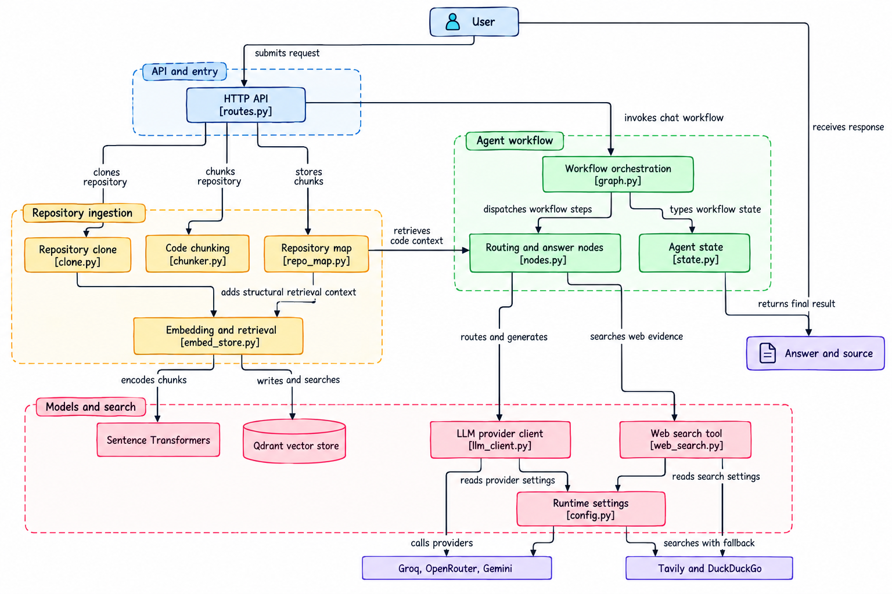
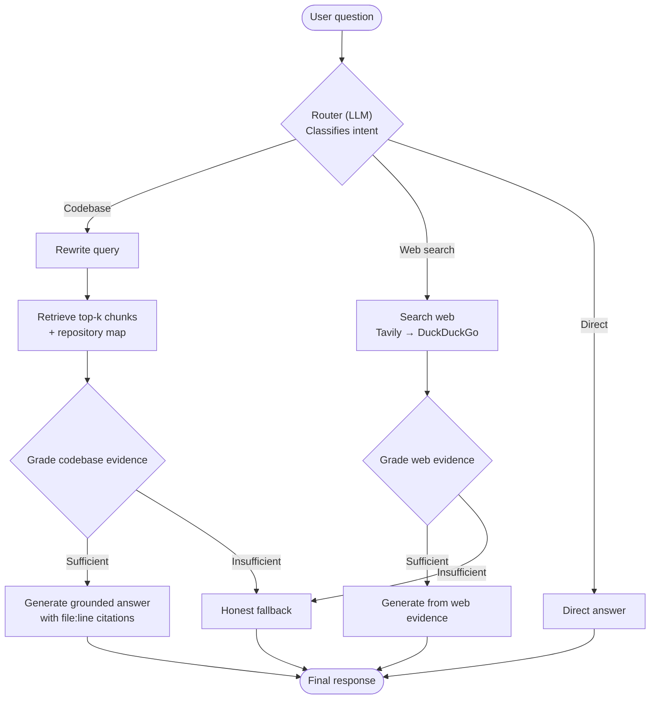

<div align="center">

# CodeSage — Agentic Codebase RAG Assistant

**Ask questions about a GitHub repository. Get evidence-backed answers with file and line citations.**

[](https://www.python.org/)
[](https://fastapi.tiangolo.com/)
[](https://langchain-ai.github.io/langgraph/)
[](https://qdrant.tech/)
[](https://www.docker.com/)

*A repository-aware AI assistant that combines code retrieval, agentic routing, evidence grading, and web-search fallback.*

</div>

---

## Overview

CodeSage is an agentic Retrieval-Augmented Generation (RAG) system that answers natural-language questions about GitHub repositories. Ask about project architecture, specific functions, implementation details, or error messages. Answers can cite exact source files and line ranges.

When the repository does not contain enough evidence, the agent can route a question to web search. If the available evidence is still weak, it can return an honest insufficient-evidence response rather than inventing an answer.

### Why CodeSage?

- **Understand unfamiliar codebases:** Explore how files, functions, and components fit together.
- **Cited answers:** Retrieve AST-aware code chunks with file and line metadata.
- **Agentic routing:** Decide whether a question belongs to the codebase, web search, or a direct response.
- **Evidence grading:** Check whether retrieved context is sufficient before generating a grounded answer.
- **Structural context:** Include a repository map to help answer architecture-level questions.
- **Provider fallback:** Use alternative LLM and web-search providers when the primary provider fails or reaches a limit.

> **Implementation note:** The Docker-sandboxed code-execution tool is present in the project, but the current README/source notes indicate it is not wired into the agent graph by default.

---

## Architecture

The diagram below shows the main request path, repository ingestion components, LangGraph workflow, vector retrieval, and external model/search providers.

<p align="center">
  
</p>

### Agent Decision & Self-Correction Workflow

<p align="center">
  
</p>

<details>
<summary>View Mermaid flowchart</summary>



</details>

### How codebase understanding works

1. **AST-aware chunking** — Tree-sitter extracts function/class-oriented code chunks and records source location metadata.
2. **Repository structure** — A repository map summarizes the directory tree, imports, README, and configuration context.
3. **Context assembly** — Retrieval can include the repository map alongside relevant code chunks, supporting both specific and architecture-level questions.
4. **Evidence-aware response** — The workflow grades retrieved context before generating an answer or taking a fallback path.

---

## Technology stack

| Layer | Technology | Purpose |
|---|---|---|
| API | FastAPI | Ingestion and chat endpoints |
| UI | Streamlit | Interactive chat interface and visible workflow steps |
| Agent orchestration | LangGraph | Routing, workflow state, grading, and response flow |
| Code parsing | Tree-sitter | AST-aware chunking |
| Embeddings | `sentence-transformers/all-MiniLM-L6-v2` | Local text embeddings |
| Vector database | Qdrant | Store and retrieve code chunks |
| LLM providers | Groq, OpenRouter, Gemini | Model generation and provider fallback |
| Web search | Tavily, DuckDuckGo | External evidence fallback |
| Containers | Docker / Docker Compose | Qdrant and deployment services |
| Evaluation | RAGAS | Faithfulness and answer-relevancy evaluation |

The project is designed around free/open-source tooling and free provider tiers. Provider limits and pricing can change, and API keys may be needed for some providers.

---

## Project structure

```text
codebase-rag-agent/
├── requirements.txt
├── docker-compose.yml
├── .env.example
├── app/
│   ├── config.py
│   ├── ingestion/
│   │   ├── clone.py
│   │   ├── chunker.py
│   │   ├── repo_map.py
│   │   └── embed_store.py
│   ├── agent/
│   │   ├── state.py
│   │   ├── llm_client.py
│   │   ├── nodes.py
│   │   └── graph.py
│   ├── tools/
│   │   ├── web_search.py
│   │   └── code_exec.py
│   ├── api/
│   │   └── routes.py
│   └── frontend/
│       └── streamlit_app.py
└── eval/
    ├── eval_dataset.py
    └── run_eval.py
```

---

## Getting started

### Prerequisites

- Python **3.13**
- Docker and Docker Compose
- API keys for the providers you intend to use: [Groq](https://console.groq.com/), [OpenRouter](https://openrouter.ai/), [Google AI Studio](https://aistudio.google.com/), and [Tavily](https://tavily.com/)

DuckDuckGo search is configured as a fallback and may not require an API key.

### 1. Clone the repository

```bash
git clone <your-repository-url>
cd codebase-rag-agent
```

### 2. Start Qdrant

```bash
docker compose up -d
```

Qdrant is expected to be available at `localhost:6333` for the local setup.

### 3. Install dependencies

Use Python 3.13 for the pinned Tree-sitter dependency combination described by the project.

```bash
pip install torch --index-url https://download.pytorch.org/whl/cpu
pip install -r requirements.txt
```

### 4. Configure environment variables

```bash
cp .env.example .env
```

Add the provider keys and any deployment-specific settings to `.env`. Do not commit real API keys.

### 5. Run the backend and frontend

In terminal 1:

```bash
uvicorn app.api.routes:app --reload --port 8010
```

In terminal 2:

```bash
streamlit run app/frontend/streamlit_app.py
```

Open the Streamlit UI at **http://localhost:8501**. Paste a public GitHub repository URL into the sidebar and start ingestion. The frontend uses `http://localhost:8010` by default; set `API_URL` if the backend runs elsewhere.

---

## API endpoints

The project notes identify these API routes:

| Endpoint | Purpose |
|---|---|
| `/ingest` | Ingest a repository |
| `/ingest/async` | Start asynchronous ingestion |
| `/ingest/status` | Check ingestion status |
| `/chat` | Ask a question |
| `/chat/debug` | Inspect chat/debug information |
| `/repos` | List ingested repositories |

For interactive API documentation during local development, open **http://localhost:8010/docs**.

---

## Deployment

The project includes a production Docker Compose configuration for the FastAPI backend, Streamlit frontend, and Qdrant.

### Option A — Docker on a VM

On a VM with Docker and Git installed:

```bash
git clone <your-repository-url>
cd codebase-rag-agent
cp .env.example .env
# Add your environment variables
docker compose -f docker-compose.prod.yml up -d --build
```

Typical local-to-VM service ports from the project configuration:

- Streamlit UI: `8501`
- FastAPI: `8010`
- Qdrant: `6333`

Use a reverse proxy such as Caddy or Nginx for HTTPS, and restrict direct access to backend/database ports as appropriate. Confirm the Compose port bindings and firewall rules before exposing the deployment publicly.

### Option B — Managed app host + Qdrant Cloud

1. Create a Qdrant Cloud cluster and obtain its URL and API key.
2. Deploy the Docker-based backend as a web service.
3. Configure the required LLM/search provider environment variables and Qdrant connection values.
4. Deploy Streamlit separately if required, setting `API_URL` to the backend URL.
5. Verify persistent storage, service networking, and provider connectivity.

**Deployment caveat:** The code-execution tool is described as not connected to the agent graph by default. If it is later enabled, review its Docker daemon/socket requirements and security boundary before selecting a hosting platform.

---

## Example demo walkthrough

1. Ingest a public GitHub repository through the Streamlit sidebar.
2. Ask a codebase question, such as: **“How does the router decide where to send a question?”**
3. Check that the answer includes relevant source file and line citations.
4. Ask a general development question, such as: **“What does `ECONNREFUSED` mean?”**, to exercise web-search routing.
5. Ask a question that neither source can answer and verify that the system communicates the evidence gap.
6. Observe the routing and grading steps exposed in the UI.

---

## Evaluation

The project uses RAGAS to evaluate dimensions including faithfulness and answer relevancy across codebase, web-fallback, and insufficient-evidence scenarios.

Add actual evaluation results after running the evaluation pipeline:

```text
Faithfulness:          <measured result>
Answer relevancy:      <measured result>
Dataset size:          <number of questions>
Evaluation date:       <date>
```

Do not publish placeholder scores as measured results. A lower faithfulness score on answers intentionally generated from fallback sources may reflect that those answers are not grounded in the repository; interpret metrics in the context of the source path.

---

## Design decisions

- **AST-aware chunks over arbitrary fixed-size chunks:** preserves meaningful function/class boundaries and source metadata.
- **Repository map alongside code retrieval:** adds project-level context for questions spanning multiple files.
- **Evidence grading before generation:** reduces the chance of treating weak retrieval as sufficient evidence.
- **Provider fallback cascades:** improves resilience to rate limits and provider failures.
- **Honest fallback behavior:** makes missing evidence explicit rather than presenting unsupported claims as facts.
- **Local embeddings and self-hostable vector storage:** keeps core retrieval components under the developer's control.

---

## Known limitations

- Multi-turn conversation context should be verified before assuming chat history is carried across requests.
- Repository ingestion is described as a URL-plus-button flow rather than a multi-step ingestion wizard.
- Retrieval is scoped to the ingested repository; re-ingestion replaces that repository's chunks.
- Class-level chunking may produce large chunks for classes with many methods.
- The code-execution tool exists in the project structure but is not wired into the agent graph by default.
- Evaluation scores should be added only after running the evaluation pipeline.

---

## Contributing

Issues, bug reports, and pull requests are welcome. When reporting a retrieval or citation issue, include a minimal reproducible question and, when possible, the repository/file involved. Never include secrets, private source code, or API keys in public issues.

## License

Add the license that applies to this repository before distributing the project.

---

<div align="center">

**Built to make unfamiliar codebases easier to explore — with evidence, not guesswork.**

</div>
